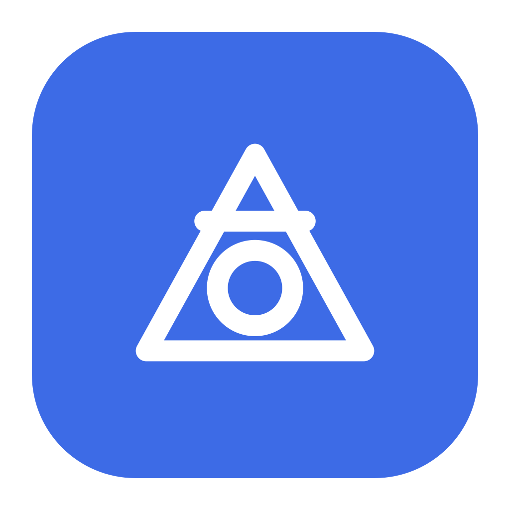

<p align="center"></p>

# Alchemist

**Every video tool. One light app.** Record your screen, edit, convert, compress and enhance video in one fast, private desktop app for Windows, macOS and Linux. Everything runs on your computer: no account, no cloud, no telemetry.

## What it does

- **Record** a screen, a window or an area, with microphone and computer sound on separate tracks and an optional camera bubble. Supports standard presets (30, 60 fps) and high refresh-rate / custom frame rates up to 240 fps (120, 144, 165, 240 fps) for silky smooth gameplay. Start and stop from anywhere with `Ctrl Shift R`. Saved continuously, so a crash loses about a second; interrupted recordings are recovered on the next launch.
- **Instant Replay**: Keep the last 15s to 2 min rolling in a background buffer and save clutch gaming moments instantly to your Replays folder with `Ctrl Shift S`, at full resolution and framerate without re-encoding.
- **Edit** on a multi-track timeline: split, trim, move with snapping, ripple delete, duplicate, speed, reverse, freeze frame, crop/rotate/flip, fades, text, highlights, boxes, blur and pixelate regions, picture-in-picture, captions (type or import SRT/VTT), markers and in/out ranges. Auto-zoom follows your clicks from the recording; silent pauses are found and removed in one click. Undo survives restarts, projects autosave.
- **Convert & compress** without opening the editor: shrink to a target size ("under 25 MB"), change format (MP4, WebM, MOV, MKV, GIF, MP3, M4A, WAV) with lossless re-wrapping when possible, custom size and frame rate (presets up to 240 fps plus custom inputs), a 5-second before/after preview, and an honest report with the real size saved and a measured quality score (VMAF or SSIM).
- **Enhance**: sharpen, remove noise, stabilise, upscale 2×, fix interlacing, HDR to normal.
- **Export** with five plain presets: best for sharing, vertical for phones, small file, GIF, audio only. Exports run in the background.
- **Find anything** with `Ctrl K`: actions, projects, recent files, settings and help in one search.
- **Production-grade UI**: Modern glassmorphic interface with rim lighting, instant native tooltips, streamlined 72px rail navigation, and Raycast-style command palette.
- **Ten themes** (five dark, five light, including high contrast), follow-system, accent colours, text size, and your own theme files. Every theme is tested for WCAG AA contrast.
- **Updates itself** from GitHub Releases, verified against a signature, never during a recording or export. Or choose "just tell me" or "never".
- **Installer or portable** on every OS. Portable mode keeps everything in a `data` folder next to the app.

## Download

Get the latest version from the website's download page (`site/download/`) or [GitHub Releases](https://github.com/jeelnadaa/alchemist/releases/latest).

| | Installer | Portable |
|---|---|---|
| Windows 10/11 (x64, arm64) | `…-windows-x64-setup.exe` | `…-windows-x64-portable.zip` |
| macOS 12+ (Apple silicon, Intel) | `…-macos-arm64.dmg` | `…-macos-arm64-portable.zip` |
| Linux (x64, arm64) | `.deb`, `.rpm` | `.AppImage`, `.tar.gz` |

Verify downloads against `SHA256SUMS.txt` in each release.

## How it's built

- **Tauri 2**: a Rust core with the system's web view for the UI. The app binary is about 7 MB; the Windows installer is about 23 MB, most of which is FFmpeg.
- **FFmpeg** does capture, encoding and analysis in separate processes, so heavy work never freezes or bloats the app. Hardware encoders (NVENC, Quick Sync, AMF, VideoToolbox) are used when they really work, with a software fallback.
- **Closing the window frees the web view.** Recording, background jobs and the global hotkey keep running in a small tray process.
- **No framework UI**: plain TypeScript, each screen loaded only when opened.

Layout: `app/src` (UI), `app/src-tauri/src` (Rust core), `site/` (website on Cloudflare Workers, see `wrangler.jsonc`), `scripts/` (build and release tooling), `PLAN.md` (product plan), `PROGRESS.md` (what's done and what's next).

## Develop

```bash
make deps
make run
make test
```

Details, prerequisites and signing: [BUILDING.md](BUILDING.md).

## Licence

The app's own licence hasn't been chosen yet (see PLAN.md section 9). Bundled third-party software: [THIRD_PARTY_NOTICES.md](THIRD_PARTY_NOTICES.md).
